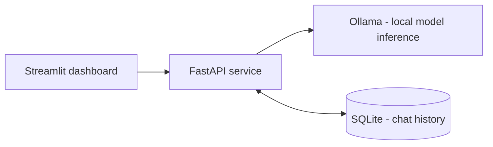

# OpenLLM Studio

A free, local Windows chat workspace using FastAPI, Streamlit, Ollama, and SQLite.
The existing `GET /` health response and `POST /chat` → `{"reply": "..."}` behavior
remain available. The dashboard now uses a separate streaming endpoint.

## Project snapshot for recruiters

**What it solves:** A private, local LLM chat workspace that runs without cloud API keys.

**How it works:** A Streamlit interface calls a FastAPI backend, which sends prompts to locally installed Ollama models (including Qwen2.5 1.5B). SQLite saves conversations so they survive application restarts.

**Implemented engineering work**
- Streaming chat responses via an NDJSON endpoint, with explicit success/error events
- Persistent and searchable conversation history, model switching and JSON/Markdown export
- Per-conversation generation safeguards and validation for unavailable models
- Local deployment using Docker Compose, plus automated API and dashboard tests

**Verification:** [VALIDATION.md](VALIDATION.md) records **30 passing pytest tests** and passing Ruff checks on **3 November 2026**. The automated suite **mocks Ollama**; those results do not establish live model accuracy, throughput, or production readiness.

**Architecture**



**Trade-offs:** This is a local portfolio application, not a public multi-user service. It lacks user authentication; run on loopback as instructed below. Model quality depends on the locally installed model and available hardware.

**Explore:** [Setup](#windows-quick-start-powershell) · [API](#api) · [Tests](#validation-and-tests)

---

## Windows quick start (PowerShell)

Replace the example `C:\\path\\to\\OpenLLM-Studio` with your local checkout folder in the commands below. Python **3.12** is recommended;
the project's existing environment was verified as 3.12.7. Do not recreate a working
environment just to run this update. Python 3.15 can lack dependency wheels, causing
source-build errors such as the earlier PyYAML failure.

```powershell
Set-Location C:\path\to\OpenLLM-Studio
# Only if .venv does not already exist:
py -3.12 -m venv .venv
.\.venv\Scripts\python.exe -m pip install -r requirements.txt
```

Install Ollama for Windows from <https://ollama.com/download/windows> if needed.
Open the Ollama desktop application, or run the following in a separate terminal
if Ollama is not already serving. An "address already in use" message usually means
it is already running; do not launch a second server.

```powershell
ollama serve
```

List existing models before downloading anything. The dashboard only lists installed
models; switching models does not download them.

```powershell
ollama list
# Optional, only if you need the original project's default model:
ollama pull qwen2.5:1.5b
```

Start the backend in one PowerShell window:

```powershell
Set-Location C:\path\to\OpenLLM-Studio
.\.venv\Scripts\python.exe -m uvicorn backend.main:app --host 127.0.0.1 --port 8000
```

Start the dashboard in another:

```powershell
Set-Location C:\path\to\OpenLLM-Studio
.\.venv\Scripts\python.exe -m streamlit run frontend\app.py --server.address 127.0.0.1 --server.port 8501
```

Open <http://127.0.0.1:8501>. API reference: <http://127.0.0.1:8000/docs>.
Use one backend worker: the per-conversation generation guard is in process.
These are personal local services, without accounts or authentication; keep their
bindings on loopback. No activation command or PowerShell execution-policy change is needed.

## Dashboard

- A Copilot-inspired workspace with a light Segoe interface, blue/violet accents,
  a navigation sidebar, a central composer, and responsive work cards.
- **Chat:** start fresh or resume one of your five most recent conversations from
  the sidebar. Responses stream live and completed turns are saved automatically.
- **Prompt library:** browse eight starters across Plan, Write, Analyze, and Code.
  Choose **Use prompt** to open an editable draft in a new chat. Replace bracketed
  details and send when ready; choosing a prompt does not call the model.
- **Conversation history:** search all saved titles, reopen conversations, and delete
  chats after an explicit **Delete permanently** confirmation. **Keep conversation** cancels.
- **Model & preferences:** choose an installed Ollama model, adjust creativity, and set
  memory from 0–50 previous complete turns (default 10). Preferences persist while
  navigating within the current session, including when starting another chat.
- **Export chat:** download the open conversation as Markdown or JSON.
- See backend/model failures, disabled input when models are unavailable, and partial-reply warnings.
- Uses native Streamlit controls, visible keyboard focus, text alongside status indicators,
  local decorative SVGs, reduced-motion support, and a default light theme in
  `.streamlit/config.toml`. Presentation markup is app-authored; conversation content
  is rendered through Streamlit Markdown without enabling HTML. Formal screen-reader
  and live browser visual testing have not been completed.

Restart Streamlit after updating dependencies or theme configuration. For Docker,
run `docker compose up --build`; the frontend image includes both the stylesheet
and theme configuration. This workspace uses the existing local Ollama backend;
the prompt cards guide chat workflows and do not execute code or connect to Microsoft 365.

## Memory and persistence

`backend/store.py` creates `data/chat.db` on backend startup, relative to the project,
not the current terminal folder. SQLite is part of Python; no database server is needed.
Messages are ordered by database ID, isolated by conversation ID, and carry timestamps
and the model used for that turn. Model switching preserves prior turns. The first
successful prompt supplies the title. Full saved history remains available even when
the memory setting sends fewer turns to Ollama. The memory limit counts turns, not tokens;
very long messages can still exceed a model's context window.

Both messages in a turn are saved in one transaction only after a completed reply.
Failed, empty, malformed, truncated, or disconnected streams do not save partial turns.
An empty conversation can remain after a failed first request; it can be reused or deleted.
If the connection drops after the server commits, reload history before retrying to avoid
repeating a successfully saved turn. Retries are not idempotent.

Previously displayed chats lived only in the old Streamlit session and cannot be recovered
from SQLite. Existing files and the original virtual environment are preserved during the update.
To back up history, stop the backend and copy `data/chat.db`. It is plain local data,
not encrypted. Deleting a conversation removes its message rows in the same transaction.

## API

| Endpoint | Behavior |
| --- | --- |
| `GET /` | Original service status |
| `GET /models` | Installed model names from Ollama `/api/tags` |
| `GET /conversations` | Titles and IDs, most recently updated first |
| `POST /conversations` | Create chat, optional `title` (1–80 nonblank characters) |
| `GET /conversations/{uuid}` | Conversation and ordered full message history |
| `DELETE /conversations/{uuid}` | Delete chat and messages; 409 during generation |
| `POST /chat` | Nonstreaming reply, conversation ID, and model |
| `POST /chat/stream` | NDJSON events: `start`, `delta`, `done` or `error` |

Chat body: `message` (1–16,000 characters, nonblank), optional `conversation_id`,
`model` (default `qwen2.5:1.5b`, must be installed), `temperature` (0–2), and
`memory_turns` (0–50). Omitting the ID creates a chat; retain the returned ID for memory.
Invalid input is 422, missing chats 404, generation conflicts 409, and unavailable
Ollama/storage 503. Streaming failures after headers are emitted as an `error` event
with HTTP 200: clients must wait for `done` before treating a response as saved.

```powershell
$body = @{ message = 'My name is Ada'; model = 'qwen2.5:1.5b' } | ConvertTo-Json
$chat = Invoke-RestMethod http://127.0.0.1:8000/chat -Method Post -ContentType application/json -Body $body
$next = @{ message = 'What is my name?'; conversation_id = $chat.conversation_id } | ConvertTo-Json
Invoke-RestMethod http://127.0.0.1:8000/chat -Method Post -ContentType application/json -Body $next
```

## Configuration

Optional environment variables, set **before** starting the corresponding service:

```powershell
# Backend only; defaults shown
$env:OLLAMA_BASE_URL = 'http://127.0.0.1:11434'
$env:OPENLLM_DB_PATH = 'C:\path\to\OpenLLM-Studio\data\chat.db'
# Dashboard only
$env:OPENLLM_API_URL = 'http://127.0.0.1:8000'
```

No cloud service, API key, paid tool, LangChain, or external database is required.
Model downloads and initial dependency installation require internet access. Existing
optional dependencies are retained for compatibility; Phase 5 uses only FastAPI,
Pydantic, HTTPX, requests, Streamlit, and Python's SQLite library at runtime.
Uvicorn's `standard` extras were removed to avoid unnecessary native/optional builds.

## Validation and tests

```powershell
Set-Location C:\path\to\OpenLLM-Studio
.\.venv\Scripts\python.exe -m pytest -q
.\.venv\Scripts\python.exe -m ruff check backend frontend tests
```

Tests use temporary SQLite databases and mocked Ollama responses, so no model download
or running server is required. Coverage includes legacy compatibility, isolated memory,
memory limits, model switching, reopened databases, successful and failed streaming,
validation, unavailable Ollama, conflict handling, deletion cascades, and dashboard
ready/empty-model/offline states. See `VALIDATION.md` for the actual run results.

Manual check: ask "My name is Ada", then "What is my name?"; switch models and ask again;
restart both services and reopen the chat; start another chat and confirm it has no memory
of Ada. Check keyboard navigation and your preferred light/dark theme.

Protocol references: [Ollama chat](https://docs.ollama.com/api/chat),
[installed models](https://docs.ollama.com/api/tags),
[Streamlit chat elements](https://docs.streamlit.io/develop/api-reference/chat).
